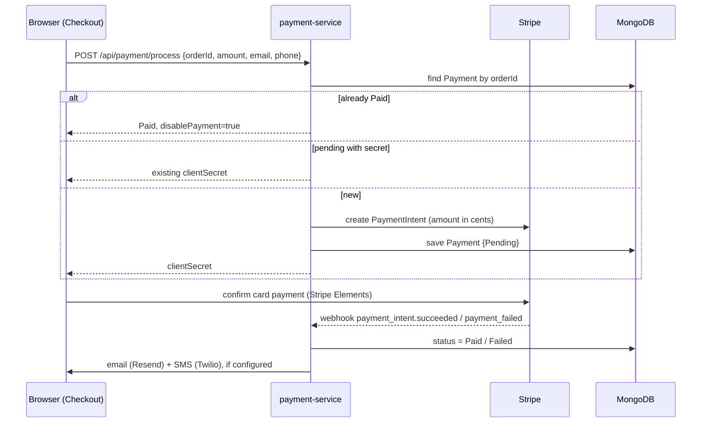
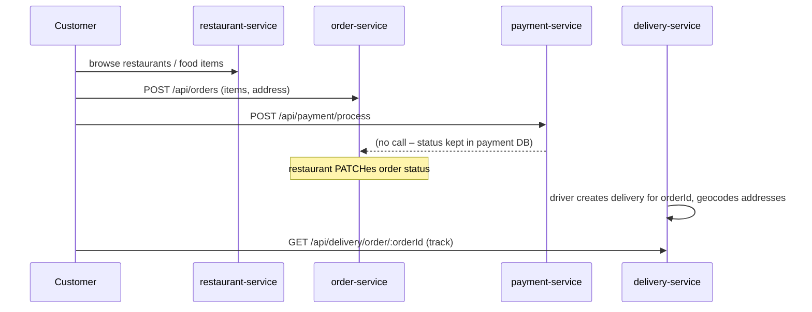

# Swigato – Low-Level Design

Author: Vignesh Chaurasia

This document describes the system as implemented in this repository.

## 1. System context

```mermaid
flowchart LR
  C[Customer / Restaurant / Admin browser] --> FE[frontend · React]
  D[Driver browser] --> DFE[delivery-frontend · React]
  FE --> AUTH[auth-service :4000]
  FE --> REST[restaurant-service :5002]
  FE --> ORD[order-service :5005]
  FE --> PAY[payment-service :5004]
  DFE --> DEL[delivery-service :5003]
  DFE -. Socket.IO .-> DEL
  PAY --> STRIPE[(Stripe)]
  STRIPE -- webhook --> PAY
  PAY --> TW[(Twilio SMS)]
  PAY --> RS[(Resend email)]
  DEL --> OC[(OpenCage geocoding)]
  AUTH & REST & ORD & PAY & DEL --> M[(MongoDB Atlas · one database per service)]
```

Each service owns its database (`swigato_auth`, `swigato_restaurant`, `swigato_order`, `swigato_delivery`, `swigato_payment`). Services never query each other's database and do not call each other over HTTP; the React apps orchestrate the calls and cross-service references are plain string IDs.

## 2. Common conventions

- **Stack:** Node.js + Express, Mongoose. Auth, payment use CommonJS; order, restaurant, delivery use ES modules.
- **Auth:** `Authorization: Bearer <JWT>`. Tokens are signed with the shared `JWT_SECRET`; the payload is `{ id, role }`. Passwords are hashed with bcrypt.
- **Roles:** `customer`, `restaurant`, `admin`, `delivery`.
- **Config:** every value comes from environment variables (`.env.example` per service).

## 3. Services

### 3.1 auth-service (customers)

**Model `Customer`:** `firstName`, `lastName`, `email` (unique, lowercase), `phone`, `password` (min 6, bcrypt cost 12 in a pre-save hook), `location?`. Method `comparePassword`.

| Method | Path | Auth | Purpose |
|---|---|---|---|
| POST | `/api/auth/register/customer` | – | create customer, return JWT `{id, role:"customer"}` |
| POST | `/api/auth/login` | – | verify password, return JWT |
| GET | `/api/auth/profile` | JWT | read profile |
| PATCH | `/api/auth/profile` | JWT | update profile |

CORS is limited to `CLIENT_URL` with credentials. `Admin`, `DeliveryPersonnel` and `RestaurantAdmin` models/controllers exist as empty placeholders.

### 3.2 restaurant-service

**Models**
- `Restaurant`: `name`, `ownerName`, `location`, `contactNumber`, `profilePicture`, `admin{email (unique), password}`, `availability`. Admin password hashed in a pre-save hook.
- `FoodItem`: `restaurant` (ref), `name`, `description`, `price`, `image`, `category`, `availability`.
- `SuperAdmin`: `name`, `email` (unique), `password`.

| Method | Path | Auth | Purpose |
|---|---|---|---|
| POST | `/api/restaurant/register` | – | register restaurant (multipart, profile picture) |
| POST | `/api/restaurant/login` | – | restaurant admin login |
| GET / PUT | `/api/restaurant/profile`, `/update` | JWT | read / edit own restaurant |
| PUT | `/api/restaurant/availability` | JWT | open / close restaurant |
| POST | `/api/food-items/create` | JWT | add item (multipart image) |
| GET | `/api/food-items/` | JWT | own items |
| PUT / DELETE | `/api/food-items/:id` | JWT | edit / remove item |
| PUT | `/api/food-items/availability/:id` | JWT | toggle availability |
| GET | `/api/food-items/all` | – | all items (customer browse) |
| GET | `/api/food-items/restaurant/:restaurantId` | – | items of one restaurant |
| POST | `/api/superAdmin/register`, `/login` | – | super admin account / login |
| GET / PUT / DELETE | `/api/superAdmin/restaurants`, `/restaurant/:id` | JWT | manage all restaurants |

Images are written to `uploads/` and served at `/uploads/*`.

### 3.3 order-service

**Model `Order`:** `customerId`, `restaurantId` (strings), `items[{foodId, quantity, price}]`, `totalPrice`, `paymentStatus` (`Pending|Paid|Failed`), `status` (`Pending → Confirmed → Preparing → Out for Delivery → Delivered`, or `Canceled`), `deliveryAddress`, timestamps.

**Model `User`:** `name`, `email` (unique), `password`, `role`.

| Method | Path | Roles | Purpose |
|---|---|---|---|
| POST | `/api/users/register`, `/login` | – | order-service's own user accounts |
| POST | `/api/orders` | customer | place order |
| GET | `/api/orders`, `/api/orders/:id` | customer, restaurant | list / read |
| PATCH | `/api/orders/:id` | any logged in / restaurant | edit details / update status |
| DELETE | `/api/orders/:id` | customer | cancel |

### 3.4 payment-service

**Model `Payment`:** `orderId` (unique), `userId`, `amount`, `currency` (default `usd`), `status` (`Pending|Paid|Failed`), `email`, `phone`, `stripePaymentIntentId` (unique, sparse), `stripeClientSecret`, timestamps.

| Method | Path | Purpose |
|---|---|---|
| POST | `/api/payment/process` | create (or reuse) a Stripe PaymentIntent for an order |
| POST | `/api/payment/webhook` | Stripe events; raw body, signature verified with `STRIPE_WEBHOOK_SECRET` |
| GET | `/api-docs` | Swagger UI |



The route is idempotent per `orderId`. Twilio and Resend clients are optional; if their keys are missing, notifications are skipped.

### 3.5 delivery-service

**Models**
- `Driver`: `name`, `email` (unique, validated), `password` (`select:false`), `phone` (unique, 10–15 digits), `vehicleType` (`bike|car|truck`), `vehicleNumber`, `location` (GeoJSON Point), `status` (`available|on-delivery|offline`).
- `Delivery`: `driver` (ref), `orderId`, `customerId`, `pickupAddressString`, `pickupLocation` (Point, 2dsphere index), `deliveryAddressString`, `deliveryLocation` (Point), `status` (`assigned → Picked-up → To be delivered → Delivered`).

| Method | Path | Purpose |
|---|---|---|
| POST | `/api/auth/register`, `/login` | driver accounts |
| POST | `/api/delivery/create` | geocode both addresses, create delivery for the logged-in driver |
| GET | `/api/delivery` | driver's deliveries |
| GET | `/api/delivery/:id` | one delivery |
| PUT | `/api/delivery/:id/status` | update status |
| GET | `/api/delivery/order/:orderId` | look up by order (customer tracking) |
| DELETE | `/api/delivery/:id` | only when `Delivered` |

**Real-time:** Socket.IO server (CORS `*`). Drivers join a room named by their driver ID (`join-driver-room`). The tracking and driver-dashboard pages connect with `socket.io-client` and draw positions on a Leaflet map.

**Geocoding:** OpenCage (`OPENCAGE_API_KEY`, optional `GEOCODE_COUNTRY`, default `lk`). `assignNearestDriver` (`$near` within 10 km, status `available`) exists as a service function.

## 4. Frontends

- **frontend:** customer browse and cart (`CartContext`), order create/edit/cancel, Stripe checkout, restaurant admin dashboard, super admin dashboard, auth pages.
- **delivery-frontend:** driver register/login, delivery list and details, status updates, live map tracking, driver simulator.
- All service URLs come from `REACT_APP_*_URL`; the JWT is kept client-side and sent as a Bearer token.

## 5. End-to-end order flow



## 6. Deployment view

Render web services `fd-auth`, `fd-restaurant`, `fd-order`, `fd-delivery`, `fd-payment` (from `render.yaml`), Vercel for the React apps (`vercel.json` rewrites all paths to `index.html`), MongoDB Atlas M0.

## 7. Known gaps and next steps

1. **Fragmented identity.** Customers exist in auth-service, order-service (`User`), restaurants, super admins and drivers each in their own service. Tokens share a secret, but the same person has separate accounts per service. Consolidate into auth-service with role claims.
2. **Order and payment are not linked.** `orderId` is a string; payment-service does not update `Order.paymentStatus`, and Checkout currently posts a fixed demo order. Fix: the checkout page should use the real order, and the webhook should notify order-service.
3. **Real-time relay is thin.** The server only manages rooms; it does not yet receive and broadcast driver location or status events.
4. **Driver assignment is manual.** `assignNearestDriver` is not called; a driver creates their own delivery record.
5. **Authorization.** `PATCH /api/orders/:id` is declared twice, so the restaurant-only status route is shadowed. Ownership checks (a customer reading only their own orders) should be added.
6. **Storage.** Restaurant images are on local disk and lost on redeploy; move to object storage.
7. **Testing.** Only payment-service has tests; add integration tests per service and an API gateway.
